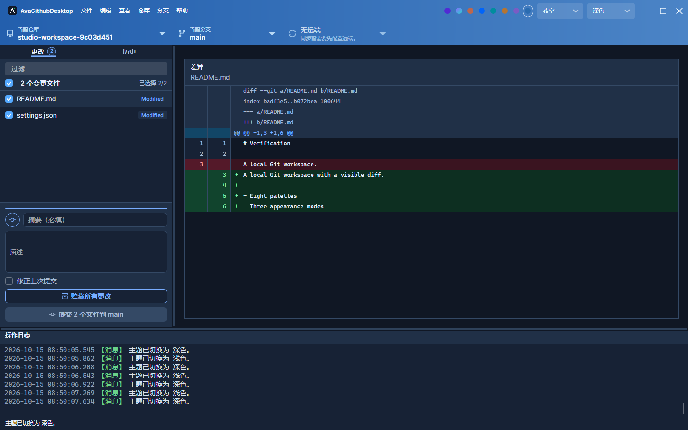
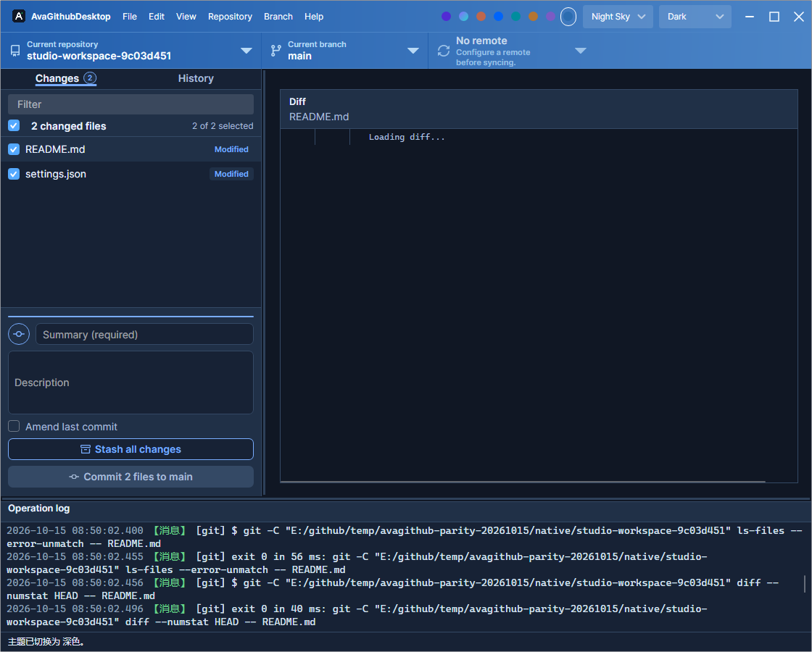
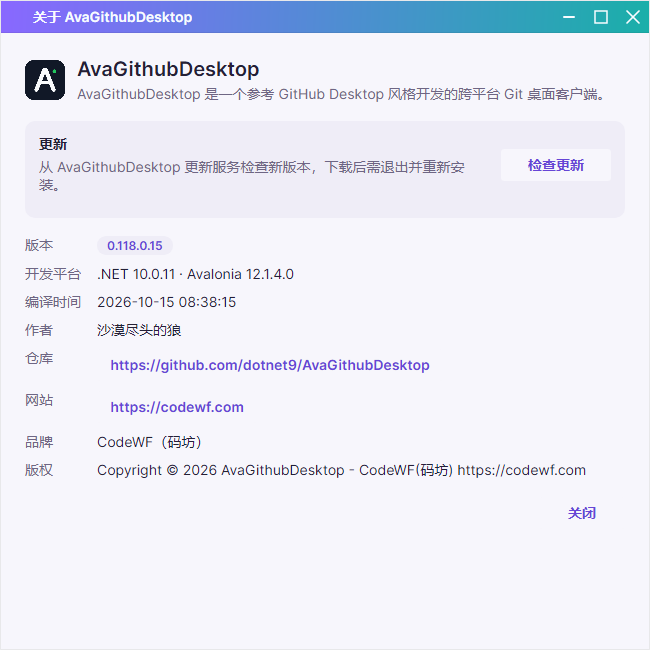
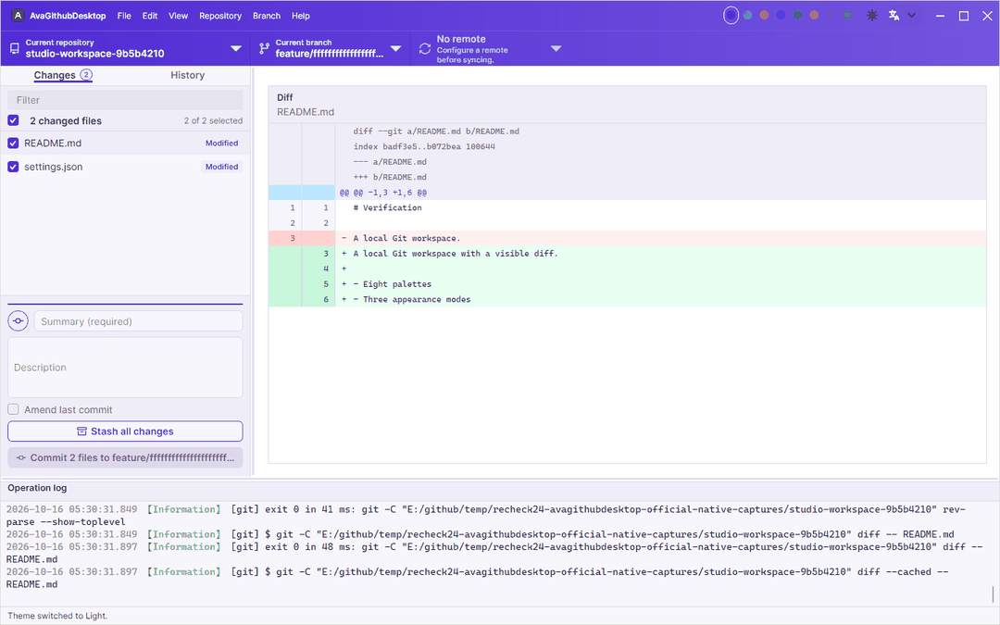

# AvaGithubDesktop

AvaGithubDesktop 是一个受 GitHub Desktop 启发的 Avalonia 桌面 Git 客户端。

## 仓库规范

- 当前版本：`0.118.0.15`，版本号统一维护在根目录 `Directory.Build.props` 的 `<Version>` 节点。
- NuGet 包项目统一支持 `net8.0;net10.0`；Demo、App、测试与内部应用项目统一使用 `net10.0` / `net10.0-windows`。
- 根目录 `logo.svg`、`logo.png`、`logo.ico` 是唯一图标源，子工程只通过 MSBuild `Link` 引用，不维护图标副本。
- 运行时帮助、Markdown 示例、内置备忘录、设计说明等业务文档按功能保留；仓库级入口文档使用根目录 `README.md` 和 `UpdateLog.md`。

## 当前功能

- 打开本地 Git 仓库，显示分支、上游、远程仓库、最近提交和工作区变更。
- 在类似 GitHub Desktop 的 Changes 面板中选择变更文件并创建提交，支持撤销更改。
- 在 History 视图中浏览最近提交，并查看所选提交的文件详情。
- 预览工作区和历史提交中选中文件的差异（统一/并排、图片与二进制 diff、隐藏空白）。
- 分支全家桶：新建/重命名/删除/切换/合并/压缩合并/变基/设置上游。
- 同步：fetch / pull / push、领先落后状态徽章、stash 贮藏/恢复/丢弃。
- 标签创建与推送、远程仓库管理（添加/设置/移除）。
- GitHub 联动：账号登录（OAuth）、在 GitHub 查看仓库/比较分支/创建 Issue 与 PR。
- 冲突解决、Revert/Cherry-pick、LFS 与子模块支持。
- 浅色、深色、跟随系统三态与八套配色分别选择并保存，包含 .NET 紫、AI 极光、AI 赤陶及 Semi 扩展配色。
- 中英双语、完整快捷键体系与操作日志；关于界面提供程序集版本、运行平台、编译时间与检查/校验下载/安装流程。

## 当前界面

以下 PNG 来自 Windows x64 NativeAOT 验证器绘制的实际 App 视图；Git 仓库为隔离目录中创建的真实样例，包含提交、变更和差异。









## 开发验证

使用 .NET 10 SDK。国际化 JSON 输出到应用的 `I18n/`，强类型资源键通过 T4 生成；库翻译保持程序集内嵌，Lang 自动支持应用同键覆盖。

```powershell
dotnet tool restore
dotnet t4 src/AvaGithubDesktop/I18n/Language.tt
dotnet build AvaGithubDesktop.slnx -c Release -m:1
dotnet run --project scripts/serialization-verification/SerializationVerification.csproj -c Release
dotnet run --project scripts/update-verification/UpdateVerification.csproj -c Release
dotnet run --project scripts/ui-verification/UiVerification.csproj -c Release -- ./artifacts/ui-verification
npm ci --prefix design/tests
npm test --prefix design/tests
pwsh scripts/publish.ps1 -RuntimeIdentifier win-x64
```

更新回归覆盖 16 个 UI 状态场景。最新离屏回归验证真实 Git 变更、差异与历史，八套配色的浅深组合，中英文 × 1440/1120 宽度，独立主题与配置恢复，以及关于窗口的动态语言切换。Windows x64 已执行仓库脚本完成 App NativeAOT 发布，并将同一 UI 验证器编译为 NativeAOT 实际运行通过；不启动真实安装器。锁屏期间未补充人工键鼠、多 DPI 或跨屏检查，Linux/macOS 未实机运行。详情见 [验收记录](docs/UI-VERIFICATION.md)。

本机联调可使用 `temp_nugets` 环境变量指定的包目录和仓外 NuGet 配置；仓库只提交正式版本 PackageReference，从 nuget.org 还原，不需要克隆库仓库。

## 包版本维护约定

XML 文件统一使用两个空格缩进。`Directory.Packages.props` 统一承载 NuGet 中央包管理开关和包版本变量，包括 `AvaloniaVersion` 等共享版本属性；`Directory.Build.props` 仅保留项目构建、编译选项和 NuGet 元数据。仓库如引用 `VC-LTL`、`YY-Thunks`，这两个兼容旧版操作系统的特殊包必须使用最新预览版。

## 发布

标准发布流程与发布说明规范见 [docs/RELEASE.md](docs/RELEASE.md)。
